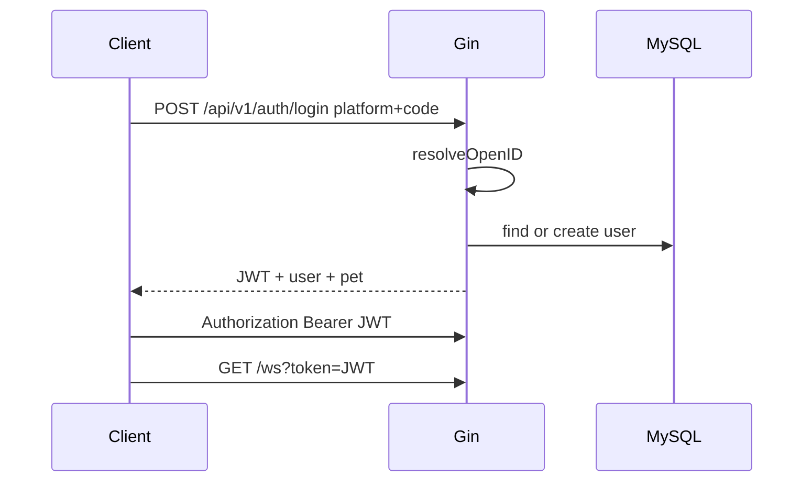

# 架构说明 · Pet Social Game MVP

## 一句话

Cocos Creator 客户端通过 HTTPS 调 Gin REST，通过 WebSocket 做即时聊天；Go 服务用 MySQL 持久化、Redis 做在线状态 / 喂养锁 / 聊天 PubSub。

## 模块

| 模块 | 职责 |
|------|------|
| `handler` | HTTP 入参校验与统一响应 |
| `service` | 登录、宠物、好友、串门、聊天业务 |
| `repo` | GORM + go-redis |
| `ws` | 连接 Hub、心跳、PubSub 扇出 |
| `security` | 内容安全 Detector（mock / alipay 骨架） |
| `middleware` | JWT 鉴权 |

## 认证流

开发环境可用 `platform=dev`，`code` 即用户标识后缀（`open_id=dev_{code}`）。

## 聊天扇出

1. 客户端 `chat.send` → 内容安全检测  
2. 通过则写入 `chat_messages`  
3. Publish 到 Redis：`pubsub:chat:world` 或 `pubsub:chat:dm`  
4. 各实例 Hub 订阅后推送给本地连接  

## 配置

见 `server/configs/config.yaml`：

- `security.provider: mock|alipay`
- `auth.allow_dev_login: true`（生产请关闭）
