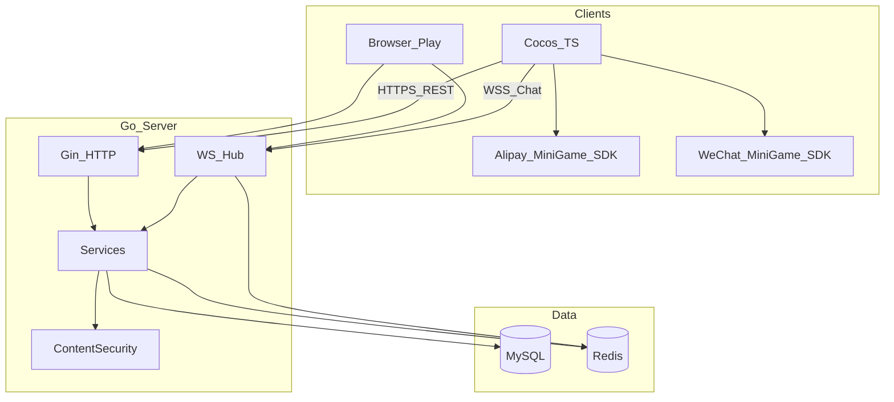
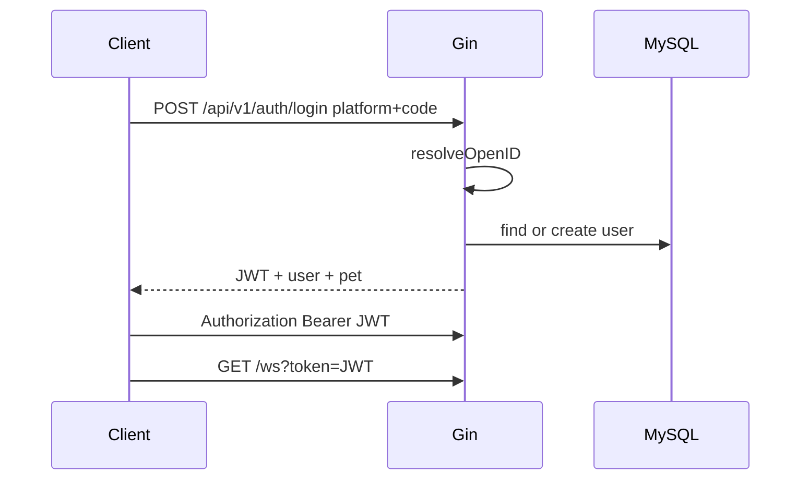

# 架构说明 · Pet Social Game MVP

> 与范围/计划文档配合阅读：[mvp-plan.md](./mvp-plan.md)

## 1. 一句话

Cocos / 浏览器试玩页通过 HTTPS 调 Gin REST，通过 WebSocket 做即时聊天；Go 服务用 MySQL 持久化，Redis 做在线状态、喂养锁与聊天 PubSub。

## 2. 架构总览



### 请求路径

| 流量 | 入口 | 下游 |
|------|------|------|
| 登录 / 宠物 / 好友 / 串门 / 历史消息 | `Gin` `/api/v1/*` | `service` → MySQL / Redis |
| 即时聊天 | `WS` `/ws?token=` | 内容安全 → 落库 → Redis PubSub → Hub 推送 |
| 试玩静态页 | `GET /play/` | 同进程静态文件（同源，无额外 CORS 依赖） |

## 3. 仓库与模块映射

```
server/internal/
├── config/       # YAML 配置加载
├── middleware/   # JWT
├── handler/      # HTTP 入参与统一响应 {code,msg,data}
├── service/      # 登录、宠物、好友、串门、聊天
├── repo/         # GORM + go-redis
├── ws/           # Hub、心跳、PubSub 扇出
├── security/     # Detector：mock | alipay 骨架
├── model/        # 表模型
└── pkg/          # jwt、response 工具
```

| 模块 | 职责 |
|------|------|
| `handler` | HTTP 入参校验与统一响应 |
| `service` | 登录、宠物、好友、串门、聊天业务 |
| `repo` | GORM + go-redis |
| `ws` | 连接 Hub、心跳、PubSub 扇出 |
| `security` | 内容安全 Detector（mock / alipay） |
| `middleware` | JWT 鉴权 |

客户端对应：

| 路径 | 职责 |
|------|------|
| `client/.../platform` | Alipay / WeChat / Dev 登录与存储 |
| `client/.../net` | HttpClient、WsClient |
| `client/.../managers` | Auth / Pet / Chat / Visit |
| `client/.../ui` | 面板脚本（Creator 内绑节点） |
| `play/` | 一期浏览器可玩 UI |

## 4. 数据模型（核心表）

| 表 | 用途 |
|----|------|
| `users` | open_id + platform、昵称头像 |
| `pets` | 等级、hunger、mood、outfit_json |
| `friendships` | pending / accepted |
| `chat_messages` | world / friend 消息 |
| `visit_logs` | view / pet / gift |
| `items` / `user_items` | 服装与食物种子 |

详见 `server/migrations/001_init.sql`。

### Redis Key

| Key | 用途 |
|-----|------|
| `online:{userId}` | 在线状态 TTL |
| `lock:feed:{userId}` | 喂养分布式锁 |
| `pubsub:chat:world` | 世界聊天扇出 |
| `pubsub:chat:dm` | 私聊扇出 |

## 5. 认证流



- 开发：`platform=dev`，`open_id=dev_{code}`
- 支付宝/微信：当前将 code 映射为 `{platform}_{code}`；生产需接平台 OAuth 换 open_id
- 生产请关闭 `auth.allow_dev_login`

## 6. 聊天扇出

1. 客户端 `chat.send` → `ContentSecurity.DetectText`
2. 不通过 → `chat.rejected`，不落库、不广播
3. 通过 → 写 `chat_messages`
4. Publish Redis → 各实例 Hub 推本地连接

## 7. 配置要点

`server/configs/config.yaml`：

- `security.provider: mock|alipay`
- `auth.allow_dev_login: true`（生产关闭）
- `jwt.secret` 生产必须更换
- MySQL / Redis 连接串

## 8. 相关文档

- [MVP 范围与计划变更](./mvp-plan.md)
- [HTTP API](./api.md)
- [WebSocket 协议](./ws-protocol.md)
