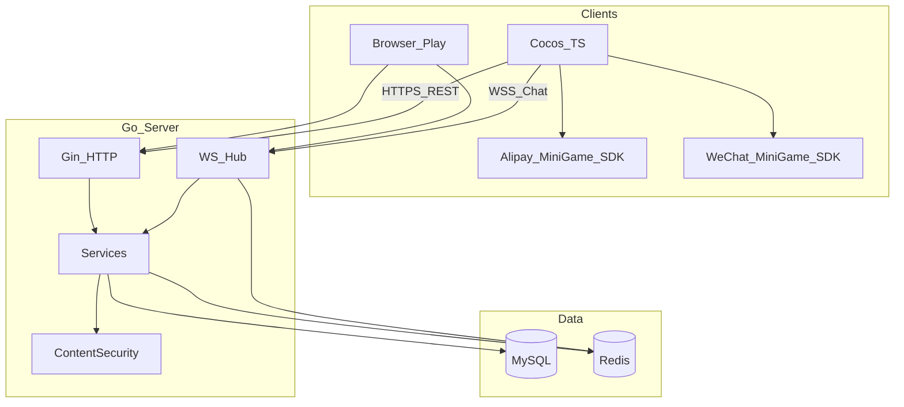

# Pet Social Game MVP（方案 B）· 产品与计划文档

> 本文档固化一期目标、范围边界、仓库结构、技术决策与计划变更记录。  
> 实现细节见 [architecture.md](./architecture.md)、[api.md](./api.md)、[ws-protocol.md](./ws-protocol.md)。

---

## 1. 目标范围（一期交付）

| 能力 | 说明 | 状态 |
|------|------|------|
| 支付宝登录 | auth code → session JWT；开发可用 `platform=dev` | 已实现（生产 OAuth 换票为骨架） |
| 宠物创建 / 喂养 / 换装 | 每用户一只宠；道具种子数据；喂养分布式锁 | 已实现 |
| 串门 | 访问好友家园、抚摸/送礼互动、visit_logs | 已实现 |
| 世界聊天 + 好友私聊 | WebSocket + Redis PubSub | 已实现 |
| 文本内容安全 | `alipay.security.risk.content.detect`；开发 mock | Mock 默认；Alipay 骨架 |
| HTTP API + MySQL + Redis | 持久化 / 缓存 / 在线状态 / 锁 / PubSub | 已实现 |
| 浏览器试玩页 | `/play/` 不依赖 Cocos，一期可玩 | 已实现（计划增补） |
| 动森气质室内 2.5D + Design System | 奶油/燕麦/淡橘色板；贴纸 UI；家园/串门/社交三场景 | 设计正稿已定；见 art-direction + refs/scene-*.png |
| Spine 微动 | 呼吸/眨眼/摇尾/表情；换装 | PetActor 已落地；美术资源待导入 |

### 明确不做 / 分期

**服务端仍分期（设计已定稿，可先做 UI 壳）**

- 晒图广场瀑布流 + OSS 上传（设计场景 3）
- 留言墙 / 特产交换完整经济（设计场景 2）
- 商城支付

**一期可玩优先**：家园 2.5D + Spine + 喂养/换装/串门基础 + 聊天抽屉；拍照本地拍立得预览可先做。

> 视觉以 [art-direction.md](./art-direction.md) Design System 为准。

---

## 2. 技术栈

**客户端**

- 引擎：Cocos Creator 3.8+（TypeScript）
- UI & 动画：Cocos GUI + **Spine 2D**；贴纸风大圆角 UI；Q 弹反馈
- 视觉：Design System 奶油/燕麦/淡橘 + 2.5D 室内家园（见 [art-direction.md](./art-direction.md)）
- 网络：HTTP/HTTPS + WebSocket
- 适配：支付宝 | 微信小游戏
- 联调：`play/` 静态页（同域托管）

**服务端**

- Go + Gin + GORM + go-redis + gorilla/websocket
- MySQL（用户/宠物/道具持久化）
- Redis（缓存/在线状态/分布式锁/聊天 PubSub）
- 内容安全：接口抽象 + mock / alipay

---

## 3. 仓库结构

```
/opt/infra/workspace/pet-social-game/
├── README.md
├── docs/
│   ├── mvp-plan.md            # 本文：范围与计划
│   ├── architecture.md        # 架构总览与模块
│   ├── api.md
│   └── ws-protocol.md
├── play/                      # 浏览器试玩（一期可玩）
├── server/                    # Go + Gin
│   ├── cmd/api/main.go
│   ├── configs/config.yaml
│   ├── go.mod
│   ├── internal/
│   │   ├── config/
│   │   ├── middleware/        # JWT
│   │   ├── handler/
│   │   ├── service/
│   │   ├── repo/
│   │   ├── ws/
│   │   ├── security/
│   │   ├── model/
│   │   └── pkg/
│   ├── migrations/
│   └── docker-compose.yml
└── client/                    # Cocos Creator 3.8+ TS 骨架
    ├── assets/scripts/
    │   ├── net/
    │   ├── platform/
    │   ├── managers/
    │   ├── ui/
    │   └── config/
    ├── package.json
    └── README.md
```

远程仓库：https://github.com/forky-jezzz/pet-social-game

---

## 4. 架构总览

详见 [architecture.md](./architecture.md) 完整图与数据流。摘要：



---

## 5. 关键默认决策（重点）

| 决策项 | 选择 |
|--------|------|
| MVP 范围 | 方案 B（养成 + 社交聊天，不含晒图广场） |
| 项目路径 | `/opt/infra/workspace/pet-social-game/` |
| 服务端 | Go 1.22+ / Gin / GORM / go-redis / gorilla/websocket |
| 鉴权 | JWT HS256；`platform=dev` 联调登录 |
| 内容安全 | 默认 `mock`；配置密钥后切 `alipay` |
| 客户端正式端 | Cocos 脚本骨架；场景在 Creator 内绑定 |
| 可玩性 | 增加 `play/` + 服务端静态托管，保证一期可试玩 |
| 模块代理 | `GOPROXY=https://goproxy.cn,direct` |

---

## 6. 计划变更记录（Changelog）

| 日期 | 变更 | 原因 |
|------|------|------|
| 2026-09-25 | 选定 MVP **方案 B**（相对纯养成 A / 全功能 C） | 一期需含世界/好友聊天与内容安全，但排除晒图/投票/OSS |
| 2026-09-25 | 目录名 `pet-social-game`；服务端确认 Go+Gin | 与用户确认 |
| 2026-09-25 | 增补 `play/` 浏览器试玩页，并由 API 托管 `/play/` | 无 Cocos 时也能端到端试玩社交与养成 |
| 2026-09-25 | 主文档拆分为 mvp-plan / architecture / api / ws | 范围与架构、协议分离，便于后续改计划只改本文 |
| 2026-09-25 | 推送 GitHub `forky-jezzz/pet-social-game` | 版本管理与协作 |
| 2026-09-25 | 视觉定为 **2D 温馨小家 / 旅行青蛙气质**；参考养成手游布局但不抄海岛农场风 | 用户确认画风；详见 [art-direction.md](./art-direction.md) |
| 2026-09-25 | 画风改为 **日系手绘像素**；一期加入 Spine 呼吸/眨眼/摇尾与表情动作 | 用户确认；规范见 [spine-pet.md](./spine-pet.md)，脚本 `PetActor` |
| 2026-09-25 | 氛围对齐 **《我的花园世界》** 温馨室内小动物家居；手法仍为手绘像素、禁止抄素材 | 用户提供参考图；更新 [art-direction.md](./art-direction.md) |
| 2026-09-25 | 否定粗像素示意；改为 **女性向粉彩柔美花园庭院**（参考用户花园图气质，不抄） | 新示意 `docs/refs/pet-feminine-garden-reference.png` |
| 2026-09-25 | **推翻前序示意图**；视觉改为直接参考 **《动物森友会》** 2D 温馨生活气质（不抄 IP） | 删除旧 refs；新示意 `docs/refs/pet-acnh-inspired-reference.png` |
| 2026-09-25 | 落地完整 **Design System**：色板/贴纸 UI/三场景（家园·串门·社交）；删除旧庭院示意；产出 scene-01/02/03 | 用户规范；[art-direction.md](./art-direction.md) |

后续若调整范围（例如提前做晒图），请在本表追加一行，并同步更新「目标范围」表格状态列。

---

## 7. 数据与协议索引

- 表结构：`server/migrations/001_init.sql`
- Redis：`online:{userId}`、`lock:feed:{userId}`、`pubsub:chat:world` / `pubsub:chat:dm`
- HTTP：[api.md](./api.md)
- WebSocket：[ws-protocol.md](./ws-protocol.md)

---

## 8. 验收清单（一期）

- [x] `docker compose up` 后 API `/healthz` 正常
- [x] 开发登录拿 JWT，创建宠物、喂养、换装
- [x] 双用户加好友、串门互动
- [x] 世界聊天 / 私聊经 WS 互通
- [x] 敏感词 mock 拦截 `chat.rejected`
- [x] 浏览器打开 `/play/` 可完成上述流程
- [x] Cocos 脚本与平台适配骨架齐全（场景绑定需 Creator）
- [x] Design System + 三场景示意 `docs/refs/scene-0{1,2,3}-*.png`
- [x] Spine 微动规范与 `PetActor`
- [ ] Creator 按 art-direction 搭建 MainRoom / Visit / SocialHub
- [ ] 晒图 OSS + 广场 API（设计已定，服务端分期）
